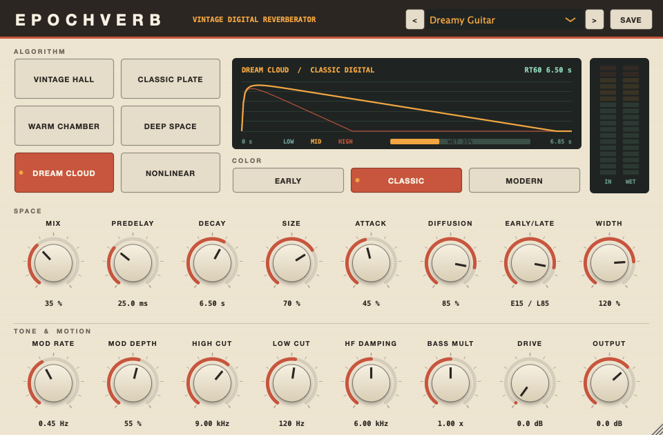

# EpochVerb results

Page: https://7onething1.github.io/epochverb/

**EpochVerb is a compiled, installed 64-bit VST3 reverb** with six original algorithms and three converter color modes. Ableton Live 11.3.43 scans it and loads it on an audio track.

The interface as rendered by the plug-in's own editor code, preset Dreamy Guitar. It resizes from 760 to 1520 px wide.

- **47 / 47**: Steinberg VST3 validator
- **SUCCESS**: pluginval, strictness 10
- **69 / 69**: host checks on the installed VST3
- **105 / 105**: DSP measurement rows pass
- **Loaded**: in Live 11.3.43 on an audio track
- **10 items**: still need you at the controls in Live

## Listen

A synthetic phrase of six plucked notes and two snare hits, 35% wet. Every clip is loudness matched to -18 LUFS. These are offline renders from the same engine the plug-in runs.

**Dry** The phrase with no reverb.

**Vintage Hall** CLASSIC, 3.5 s decay.

**Classic Plate** CLASSIC, 3.5 s decay.

**Warm Chamber** CLASSIC, 1.4 s decay.

**Deep Space** CLASSIC, 8 s decay, Attack 50%, deeper modulation.

**Dream Cloud** CLASSIC, 8 s decay, Attack 50%, deeper modulation.

**Nonlinear Gate** CLASSIC, 0.45 s gate.

**Hall, Early Digital** EARLY, 7 kHz bandwidth, 10-bit grain, sample-and-hold.

**Hall, Modern** MODERN, Full bandwidth, clean.

## Engines

| Algorithm | Structure | Character |
|---|---|---|

| Vintage Hall | 8-line feedback delay network, Hadamard mixing, two modulated allpasses per loop, 3-band decay filter | Dense chorused hall, long smooth tails |
|---|---|---|

| Classic Plate | Figure-eight tank after Dattorro (1997), stereo-fed, modulated tank allpasses | Bright diffuse plate |
|---|---|---|

| Warm Chamber | Short 8-line network, 22 early reflection taps | Intimate room |
|---|---|---|

| Deep Space | 16-line network, three-stage input smear, 85% random modulation | Slow-building stereo wash |
|---|---|---|

| Dream Cloud | 8-line network, deep modulation on delays and allpasses | Ultra-smooth atmospheric tails |
|---|---|---|

| Nonlinear Gate | 48-tap diffused burst under a gate or reverse envelope | 80s gated snare, reverse swells |
|---|---|---|

Color modes change the signal path. **Early** band-limits to 7 kHz and adds a 10-bit gain-ranged quantizer, 31.25 kHz sample-and-hold, signal-following hiss and unstable modulation. **Classic** runs at 11.5 kHz with 13-bit grain and gentle saturation. **Modern** is full bandwidth and clean.

## Measurements

| Measure | Result |
|---|---|

| Decay accuracy at 2 s, 60 renders (6 reverbs, 3 colors, 44.1 to 96 kHz) | -10.7% to +1.7% |
|---|---|

| Decay accuracy 0.5 to 10 s, Modern color | -6.2% to +6.6%; plate at 0.5 s -21.6% |
|---|---|

| Stereo correlation of the tail | -0.02 to +0.05 |
|---|---|

| Largest DC offset | 3.9e-10 |
|---|---|

| Random automation of every parameter, 20 s per algorithm | finite, bounded by the 2.0 soft limit |
|---|---|

| Residual 15 s after the input stops | below 1e-28 |
|---|---|

| State restore into a fresh instance | sample-identical audio |
|---|---|

| CPU, 48 kHz, one core of an i5-7500 | 18x to 54x realtime (2 to 6% of a core) |
|---|---|

| Loudness across algorithms, 2 s impulse, Classic color | matched to 0.500 ±0.001 (gate 0.350) |
|---|---|

## Reference comparison

VintageVerb is not installed on this Mac. Valhalla Supermassive is, so its impulse response (Gemini, Delay 40 ms, Feedback 75%, Density 100%) was measured with the same code as EpochVerb at 2 s decay. Tail ringing is the tallest narrow peak in the tail spectrum above a third-octave average. Pure decaying noise scores 9.1 dB, the smooth ideal.

| Source | Ringing | Bins over 11 dB | Dense after | L/R corr |
|---|---|---|---|---|

| Ideal floor, decaying noise | 9.1 dB | 0 | n/a | 0.00 |
|---|---|---|---|---|

| Valhalla Supermassive | 9.1 dB | 0 | 90 ms | 0.02 |
|---|---|---|---|---|

| EpochVerb Dream Cloud | 8.7 dB | 0 | 75 ms | 0.02 |
|---|---|---|---|---|

| EpochVerb Deep Space | 10.3 dB | 0 | 130 ms | 0.01 |
|---|---|---|---|---|

| EpochVerb Classic Plate | 11.0 dB | 0 | 255 ms | -0.01 |
|---|---|---|---|---|

| EpochVerb Vintage Hall | 11.6 dB | 1 | 60 ms | 0.01 |
|---|---|---|---|---|

| EpochVerb Warm Chamber | 13.7 dB | 9 | 25 ms | 0.03 |
|---|---|---|---|---|

Dream Cloud and Deep Space sit at the noise floor, level with the Valhalla reference. Hall shows a single stray bin. Chamber has real modal peaks at a 2 s decay.

## Verified

| Check | Result | Evidence |
|---|---|---|

| Steinberg VST3 validator, built from the official SDK | 47 passed, 0 failed | tests/validation/steinberg_validator.txt |
|---|---|---|

| pluginval strictness 10: editor, state, automation, fuzzing, threads, 44.1/48/96 kHz, blocks 64 to 1024 | SUCCESS | tests/validation/pluginval_strict10.txt |
|---|---|---|

| Installed VST3 in a host: every algorithm audible, automation, 12 programs, state, bypass, mono in, 88.2 kHz, odd blocks | 69 of 69 | tests/validation/host_test.txt |
|---|---|---|

| Preset files load; user presets save, reload and list | 6 of 6 | tests/validation/preset_test.txt |
|---|---|---|

| Live 11.3.43 plug-in scan | found, drwu EpochVerb 1.0.0, Fx|Reverb | Live PluginScanner.txt 16:33:50 |
|---|---|---|---|

| Live 11.3.43 loads it on an audio track from a set | "Restored: EpochVerb", 20 parameters | Live Log.txt 16:44:48 |
|---|---|---|

## Still to check in Live

This session does not take control of the Mac's screen, so these need you at Live. Open `tests/live/EpochVerb_LiveTest.als`, where EpochVerb already sits on the "EpochVerb Test" track, and drop in any audio clip.

- Open Audio passes through and you hear the reverb.

- Open Each of the six algorithms sounds distinct.

- Open Each knob moves its own parameter in Live's device view.

- Open The editor opens and stays responsive in Live's window.

- Open Factory presets load from the menu.

- Open A drawn automation lane plays back.

- Open Save the set, reopen it, settings return.

- Open Live's device on/off behaves.

- Open No crash in a long session.

- Open Export Audio/Video renders the reverb.

No listening tests were run in this session. Every quality claim above is an objective measurement.

## Limitations

- **Warm Chamber rings at long decays.** Its loops total about 0.18 s, which gives few modes per hertz. It is tuned for 0.3 to 1.5 s rooms.

- **Classic Plate fills in late.** Full echo density arrives at 255 ms.

- **Intel build only.** This Mac is x86_64. The README has the flag for an Apple Silicon or universal build.

- **No REA analysis.** No VintageVerb binary is on this Mac, and the DSP is original.

- **Ad-hoc signed.** Fine on this Mac. Another Mac needs Developer ID signing.

## Files

- Plug-in: `~/Library/Audio/Plug-Ins/VST3/EpochVerb.vst3`

- Project, source and build: `~/Projects/EpochVerb/`

- User manual: `~/Projects/EpochVerb/docs/USER_MANUAL.md`

- Verification report: `~/Projects/EpochVerb/docs/VERIFICATION.md`

- Measurements workbook: `~/Projects/EpochVerb/tests/out/EpochVerb_measurements.xlsx`

- Live test set: `~/Projects/EpochVerb/tests/live/EpochVerb_LiveTest.als`

- Rerun every check: `~/Projects/EpochVerb/tests/run_all.sh`

EpochVerb 1.0.0 · JUCE 8.0.4 · built and measured 2026-11-03 on an Intel iMac, macOS 13.7.8. Original DSP. Valhalla, VintageVerb and Supermassive are products of Valhalla DSP, used here as a named reference only.
